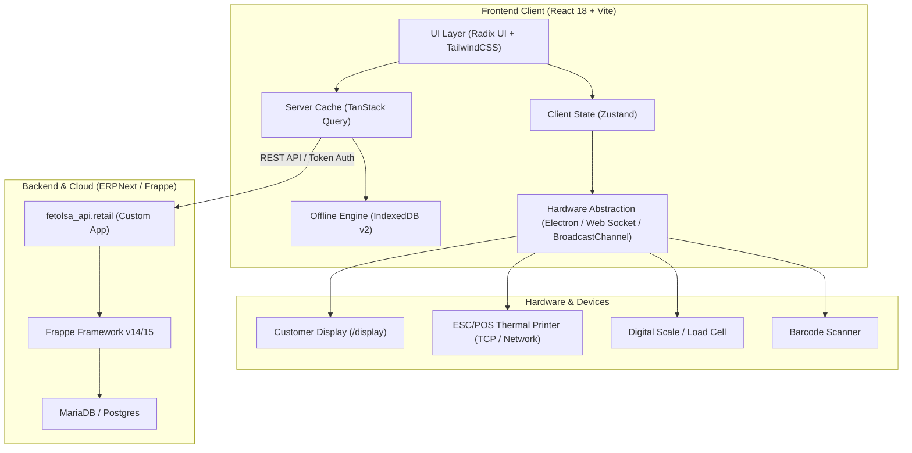
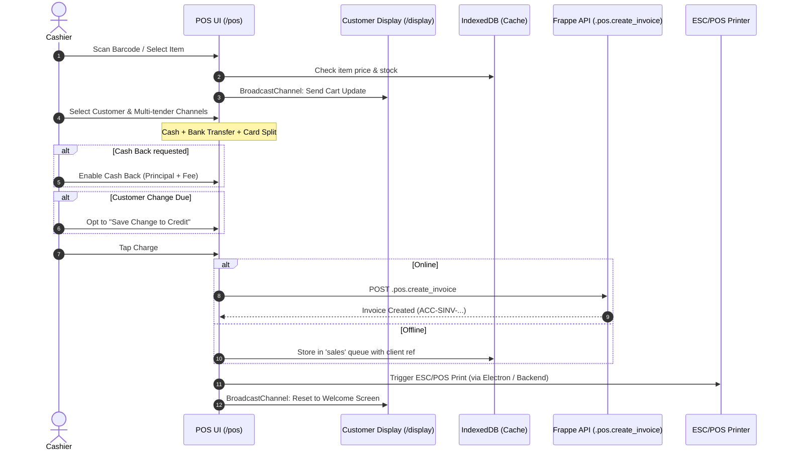
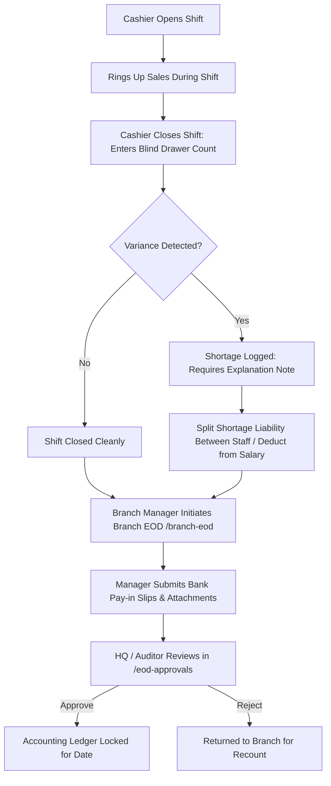

# Fetolsa Retail POS: Comprehensive Architecture & Product Deep-Dive

This document provides a complete technical and business analysis of **Fetolsa Retail POS** (`https://retail.fetolsa.app/`), extracted and reconstructed from the application's runtime codebase, API contracts, design system, and business logic.

---

## 1. Executive Summary & Product Mission

**Fetolsa Retail POS** is an enterprise-grade, offline-resilient Point of Sale and Retail Operations Management platform tailored specifically for businesses in the **Nigerian market**. Unlike generic retail POS applications, Fetolsa is engineered as an **all-in-one verticalized operating system** serving:
- **General Supermarkets & Retail Stores** (fast barcode scanning, multi-tender split payments, loyalty points, customer credit, pickup orders).
- **Cooking Gas (LPG) Refilling Plants** (pricing per kilogram, customer cylinder fleet tracking, deposit management, digital scale / load cell readings, refill prediction engine).
- **Petrol / Fuel Filling Stations** (fuel pump nozzles, opening/closing totalizer meter readings, tank dip reconciliations, attendant phone shifts, generator fuel logs).
- **Transport & Haulage Logistics** (trip bookings, vendor cost vs. client pricing brokerage, consolidated invoicing).
- **Back-Office ERP Operations** (Inventory reconciliation, Procurement, Petty Cash, P&L by branch, Employee Attendance, and Nigerian Payroll with PAYE/Pension splits).

The platform is designed to operate seamlessly in low-connectivity environments through an **IndexedDB offline synchronization layer**, integrates with physical POS hardware (thermal ESC/POS printers, customer secondary displays, load cells), and acts as a specialized front-end to a **Frappe / ERPNext backend engine**.

---

## 2. Technology Stack & System Architecture



### 2.1 Frontend Stack
- **Framework & Runtime**: React 18, Vite.
- **Routing**: React Router v6 (supporting 64 registered application routes).
- **State Management**:
  - **Zustand** (`retailStore`): Manages authentication tokens, tenant Site Address (`retail_site_url`), user identity, branch/company profile, active POS profile, and real-time permission set.
  - **TanStack React Query**: Manages query caching, optimistic UI updates, background polling, and cache invalidation across all views.
- **UI Components & Styling**:
  - **TailwindCSS**: Utility-first styling with custom CSS variables.
  - **Radix UI Primitives**: Accessible headless UI components (Dialog, Drawer, DropdownMenu, Tabs, Toast, Sonner, Command/CMDK palette).
  - **Icons**: `lucide-react`.
  - **Charts & Visualizations**: `recharts` for hourly sales comparisons, inventory velocity, and financial breakdowns.
  - **Date Utilities**: `date-fns`.
- **Design System & Typography**:
  - **Headings Font**: `Syne` (modern geometric sans-serif for numbers, brand headers, and bold KPIs).
  - **Body Font**: `DM Sans` (clean, highly readable interface typography).
  - **Color Palette**:
    - **Primary / Brand**: Deep Navy (`hsl(224, 84%, 24%)` and dark sidebar `hsl(224, 84%, 11%)`).
    - **Accent / Action**: Vibrant Warm Amber / Orange (`hsl(25, 95%, 53%)`).
    - **Status Indicators**: Emerald Green for Online/Reconciled, Ruby Red for Offline/Shortages.

### 2.2 Offline-First Architecture
Because retail and fuel operations in Nigeria frequently face internet drops, Fetolsa implements a robust client-side storage architecture:
- **IndexedDB Database**: `fetolsa_offline` (Version 2).
- **Stores**:
  1. `cache`: Caches catalog items, item groups, prices, customer lists, and POS profile settings.
  2. `meta`: Stores metadata, timestamp of last sync, and offline status.
  3. `sales`: Queues offline sales with a unique client-generated `ref`. When internet connectivity is restored, sales are automatically flushed and posted to the backend.
- **Liveness Ping**: A background heartbeat fires every 30 seconds to `/api/method/fetolsa_api.retail.auth.get_user_info`. If unreachable, the UI seamlessly toggles to offline mode while displaying a live pill badge.

### 2.3 Hardware & Peripherals Integration
1. **Secondary Customer Display** (`/display`):
   - Opens a dedicated display window named `toyapa-customer-display`.
   - Synchronizes cart items, subtotal, discounts, and payable amounts in real-time using the **HTML5 `BroadcastChannel` API** (`BroadcastChannel("toyapa-customer-display")`) with a fallback to `window.localStorage` storage events.
2. **Thermal Receipt Printing (ESC/POS)**:
   - **Electron Native Mode**: When running inside the desktop Electron shell (`window.electron.isElectron`), raw ESC/POS bytes are generated by the backend and sent directly to the local thermal printer over TCP socket (`window.electron.printTCP(ip, port, bytes_b64)`).
   - **Web Browser Mode**: The web frontend routes printing commands through the server backend proxy (`/api/method/fetolsa_api.retail.printer.print_receipt_tcp`).
   - Supports reprinting with supervisor audit logging (`print.request_reprint`).
3. **Weight Scale / Load Cell**:
   - Integrates with digital scales for LPG cylinder filling, recording gross, tare, and net weights (`pumps.save_load_cell_reading`).

### 2.4 Backend Architecture (Frappe / ERPNext)
The backend is built as a custom Frappe application named `fetolsa_api`. All business operations are exposed as secure RPC endpoints following the Frappe naming convention:
- Base URL format: `https://<site_url>/api/method/fetolsa_api.retail.<submodule>.<method>`
- Authentication: Token-based header `Authorization: Token <key>:<secret>` or session bearer.

---

## 3. Navigation & Route Directory (64 Routes)

The application organizes its features into 10 sidebar sections, pinned quick-action headers, and employee self-service shortcuts:

| Route | Category | Label | Key Permissions / Access | Functionality |
| :--- | :--- | :--- | :--- | :--- |
| `/site` | Setup | Connect Store | Public | Enters tenant domain (`<store>.fetolsa.app`) |
| `/login` | Auth | Sign In | Public | Email/Password or 4-digit PIN authentication |
| `/set-pin` | Auth | Set Quick PIN | Authenticated | Sets 4-digit quick cashier unlock PIN |
| `/pos` | Header | POS Register | `view_pos` | Primary sales till, cart, barcode scan, payment |
| `/my-sales` | Header | Sales Report | `view_my_sales` | Cashier shift sales vs. branch sales breakdown |
| `/branch-eod` | Header | End of Day | `view_eod` | Branch EOD reconciliation across all tills |
| `/eod-approvals`| Header | EOD Approvals | Manager Only | Review and approve/reject submitted EODs |
| `/dashboard` | Overview | Dashboard | Manager Only | Executive revenue KPIs, yesterday comparison |
| `/reports` | Overview | Reports | `view_reports` | Detailed sales reports, item breakdown, tax |
| `/stock-performance`| Overview| Stock Performance| `view_inventory` | Hourly sales velocity, fast/slow moving items |
| `/issues` | Overview | Issue Log | `view_issues` | Operational issue ticketing & resolution |
| `/invoices` | Sell | Invoices | `view_invoices` | Invoice history, reprint, voiding, credit notes |
| `/customers` | Sell | Customers | `view_customers` | Customer directory, store credit, loyalty |
| `/pickups` | Sell | Pickups | `view_invoices` | Reserve phone orders, OTP 6-letter collection |
| `/shift` | Sell | Shift | `view_invoices` | Open/close till shift, cash drawer count |
| `/cylinders` | Sell | Cylinders | Manager Only | Gas cylinder fleet, customer deposits |
| `/fuel-ops` | Station | Fuel Ops | `view_fuel_shift` | Petrol station overview, pump status |
| `/pump-sales` | Station | Pump Sales | `view_fuel_shift` | Pump meter readings, sales by nozzle |
| `/pump-close` | Station | Close Pumps | `view_fuel_shift` | Totalizer closing, dip reading reconciliation |
| `/attendant` | Station | Pump Shift | `view_attendant_app` | Mobile pump attendant shift interface |
| `/daily-report` | Station | Daily Report | Manager Only | Station consolidated daily audit report |
| `/pumps` | Station | Pumps Config | Manager Only | Pump and nozzle hardware setup |
| `/generator-gas`| Station | Gas to Generator | Manager Only | Tracking fuel/gas used for site power generator |
| `/shortages` | Station | Shortages | Manager Only | Cash & product shortages, splitting liability |
| `/recon-report` | Station | Recon Report | `view_eod` | Pump vs. tank physical reconciliation |
| `/stock` | Supply | Stock | `view_inventory` | Physical stock levels, adjustment, receipt |
| `/stock-balance`| Supply | Stock Balance | `view_inventory` | Multi-warehouse balance overview |
| `/procurement` | Supply | Procurement | `view_procurement` | Requisitions, POs, supplier receipts, ageing |
| `/petty` | Supply | Petty Expenses | `view_petty` | Petty cash vouchers, branch expense limits |
| `/haulage` | Haulage | Haulage | `view_haulage` | Long-haul logistics tracking |
| `/transport` | Transport | Transport Dash | `view_bookings` | Fleet and transport brokerage KPIs |
| `/bookings` | Transport | Bookings | `view_bookings` | Brokered transport jobs, client vs vendor cost |
| `/transport-reports`| Transport| Transport Reports| `view_bookings` | Fleet performance and margin reports |
| `/invoicing` | Transport | Invoicing | `consolidated_invoice_create` | Consolidated corporate invoicing |
| `/vendor-recon` | Transport | Vendor Recon | `view_vendor_recon` | Transporter / driver ledger reconciliation |
| `/finance` | Finance | Finance | `view_finance` | P&L by location, Balance Sheet, Trial Balance |
| `/payroll` | Finance | Payroll | `view_payroll` | Monthly payroll runs, automated advance deductions |
| `/payroll-setup`| Finance | Payroll Setup | `view_payroll` | Salary structures, PAYE tax, pension grades |
| `/assets` | Finance | Assets | Manager Only | Fixed asset register & maintenance logs |
| `/crm-insights` | CRM | CRM Insights | `view_customers` | Churn prediction, customer lifetime value |
| `/referrals` | CRM | Referrals | `view_customers` | Customer referral codes and commission tracking |
| `/birthdays` | CRM | Birthdays | `view_customers` | Birthday alerts, discount reward voucher grants |
| `/refill-due` | CRM | Refill Due | `view_customers` | Predictive algorithm for gas cylinder refill due |
| `/loyalty-admin`| CRM | Loyalty Admin | Manager Only | Points accrual rules and redemption rates |
| `/contracts` | CRM | Contracts | Manager Only | B2B commercial agreements & customer pricing |
| `/requests` | CRM | Requests | Manager Only | Customer portal service requests |
| `/people` | People | People Directory| `view_people` | Staff profiles, compensation records |
| `/staff` | People | Staff Ops | `view_staff_performance` | Staff performance & shift assignments |
| `/attendance` | People | Attendance | `view_attendance` | Daily attendance, in/out timestamps, late flags |
| `/hr-reports` | People | HR Reports | `view_hr_reports` | Headcount, turnover, salary audit |
| `/access` | Admin | Access Hub | Owner Only | Granular RBAC, roles & permission matrices |
| `/group-prices` | Admin | Group Prices | Owner Only | Tiered price per kg for customer groups |
| `/settings` | Admin | Settings | Authenticated | Printer setup, payment channels, brand info |
| `/my-advances` | Self-Service| My Advances | `advance_request_create` | Employee salary advance requests |
| `/my-leaves` | Self-Service| My Leaves | `leave_request_create` | Employee leave application & balance |

---

## 4. In-Depth Module Analysis & Business Logic

### 4.1 Point of Sale (POS) Engine (`/pos`)

The POS engine is the operational heart of the system. It handles high-frequency retail sales while addressing the unique constraints of commerce in Nigeria:



#### Key POS Business Logic:
1. **Multi-Channel Tender Splitting**:
   Payments can be split across any combination of:
   - Cash (with physical change calculation).
   - Bank Transfer (records receiving bank institution and transfer transaction reference).
   - POS Card Terminal.
   - Store Credit / Prepayment Balance.
   - Loyalty Points redemption.
2. **Agency Banking / Cash Back at POS**:
   Customers in Nigeria often use retail checkouts like ATMs. Fetolsa natively supports **Cash Back**:
   - Customer pays via Card/Transfer for their goods plus cash amount.
   - Cashier pays out cash from the till.
   - The system books the cash withdrawal, collects a configurable convenience fee, and prevents cash drawer depletion if the till would go negative (indicated by a red warning chip).
3. **Small Change to Credit (`save_change_to_credit`)**:
   Due to the frequent scarcity of small currency notes, cashiers can automatically allocate change directly to the customer’s account balance for their next visit.
4. **Phone Orders & Reserve for Pickup (`hold_for_pickup`)**:
   - Customer calls to order goods.
   - The cashier reserves the stock and records the prepayment.
   - A cryptographically unique **6-letter pickup code** is generated and given to the customer over the phone.
   - When the customer or their courier arrives at the store, they present the code in the `/pickups` view. Entering the correct code releases the inventory and prints the invoice. Wrong codes are blocked to eliminate shrinkage.

---

### 4.2 Shifts, Cash Reconciliation & End of Day (EOD)

Fetolsa uses a strict **two-tier blind reconciliation workflow** to combat employee theft and cash discrepancies:



1. **Shift Management (`/shift`)**:
   - Cashiers record opening float.
   - During the shift, cash drawer balance is calculated automatically (Sales + Deposits - Cash Back - Shortage Repayments).
2. **Shortage Splitting (`shortages.split_shortage`)**:
   - If physical cash does not match system expected revenue, the shortage is logged.
   - The system allows assigning percentage or fixed liability to specific attendants or till operators, which connects directly to the payroll module for automated salary deduction.
3. **Branch EOD (`/branch-eod`) & Approvals (`/eod-approvals`)**:
   - Consolidates all till receipts, fuel meter sales, LPG bulk sales, and petty cash expenses for the day.
   - Bank deposit slips and bank transfer summaries must be attached.
   - Once approved by the auditor or owner, the day's books are sealed against backdated tampering.

---

### 4.3 LPG (Cooking Gas) & Cylinder Fleet Management (`/cylinders`, `/group-prices`)

LPG operations have unique operational dynamics compared to standard barcode retail:
1. **Dynamic Per-KG Pricing**:
   - Gas is purchased in metric tonnes and sold in kilograms.
   - Through `/group-prices`, administrators set a single rate per KG for each customer tier (e.g., Walk-in Retail: ₦1,250/kg; Commercial Kitchens: ₦1,180/kg; Resellers: ₦1,120/kg).
   - The POS interface automatically calculates prices for standard cylinder sizes (3kg, 6kg, 12.5kg, 25kg, 50kg) based on `size_kg * rate_per_kg`.
2. **Cylinder Deposit & Fleet Tracking**:
   - Tracks which cylinders are **In Plant**, **With Customer**, or **In Maintenance**.
   - Selling a `CYL-` inventory item at POS automatically marks a cylinder as out with the customer and registers a monetary deposit liability.
   - Reconciles physical counts against system records to identify missing cylinders.
3. **Predictive Refill Due Engine (`/refill-due`)**:
   - Analyzes the historical purchase frequency of each customer (e.g., a family purchasing 12.5kg every 24 days).
   - Generates an automated priority list of customers who are due or overdue for gas.
   - Provides direct one-tap **WhatsApp Reminder** and **Phone Call** buttons with pre-drafted personalized greetings.

---

### 4.4 Fuel & Petrol Filling Station Operations (`/fuel-ops`, `/pump-sales`, `/attendant`)

Fetolsa provides dedicated infrastructure for operating petrol/diesel filling stations:
1. **Pump Meter / Totalizer Tracking**:
   - Every nozzle is mapped to a fuel product (PMS, AGO, DPK) and tank.
   - At shift handover, opening and closing mechanical totalizer meter readings are captured along with photo verification.
   - Sales are computed: `(Closing Meter - Opening Meter) * Pump Price`.
2. **Pump Attendant Phone Mode (`/attendant`)**:
   - Station pump attendants use a simplified mobile web interface on their smartphones.
   - They log credit sales against approved corporate vehicle fleets and tally channel collections.
   - Generates and sends an end-of-shift WhatsApp summary.
3. **Tank Dips & Returns (`record_tank_return`)**:
   - Tracks physical tank dip measurements against theoretical stock.
   - Handles pump calibration testing where fuel pumped into a test measure is poured back into the underground storage tank (`record_tank_return`), ensuring inventory is not falsely depleted.
4. **Station Generator Fuel (`/generator-gas`)**:
   - Power outages in Nigeria require diesel/gas generators to run station pumps.
   - Fetolsa provides dedicated tracking of fuel issued from station tanks to the generator, booking it as operational expense rather than unaccounted loss.

---

### 4.5 Staff, HR, Attendance & Payroll (`/people`, `/payroll`, `/payroll-setup`)

Fetolsa includes a full HRMS and Payroll subsystem compliant with Nigerian employment practices:
1. **Nigerian Salary Structure Components**:
   - Automatically breaks gross monthly pay into standard statutory components: **Basic Salary**, **Housing Allowance**, and **Transport Allowance**.
   - Handles Pension Scheme contributions and PAYE income tax brackets.
2. **Salary Advance Requests (`/my-advances`)**:
   - Employees can request salary advances via their self-service portal up to their calculated credit cap (`getMyCap`).
   - Approved advances are automatically loaded into the next payroll cycle and deducted from net pay.
3. **Daily Attendance (`/attendance`)**:
   - Logs daily employee presence per branch.
   - Flags late arrivals against the company's grace period threshold.
   - Feeds directly into payroll calculations to deduct unpaid absences.
4. **Payroll Execution (`/payroll`)**:
   - Provides a pre-run simulation preview highlighting employees missing salary assignments.
   - Generates formal payment entries on the branch cost centre and generates downloadable/email-ready **Payslip PDFs** (`payslip.getPdf`).

---

### 4.6 B2B Transport & Haulage Brokerage (`/bookings`, `/haulage`, `/vendor-recon`)

Fetolsa includes a complete logistics brokerage module (`atelier` / transport):
1. **Brokered Bookings**:
   - Records customer transport requests.
   - Captures both **Client Price** (what the customer pays) and **Vendor / Transporter Cost** (what the hired truck costs) on a single record, locking in the gross margin before dispatch.
2. **Vendor Reconciliation (`/vendor-recon`)**:
   - Reconciles payments and advances made to third-party drivers/transporters.
3. **Consolidated Invoicing (`/invoicing`)**:
   - Groups multiple trips into a single monthly corporate invoice for B2B logistics clients.

---

## 5. Complete API Surface (211+ Endpoints)

All API calls are executed through the internal transport wrapper `ee(endpoint, options)` which targets `https://<retail_site_url>/api/method/fetolsa_api.retail.<endpoint>`.

Below is a categorized index of the core API endpoints:

```
├── .auth
│   ├── .auth.login                          (POST usr, pwd -> user, full_name, token, roles, pos_profiles)
│   └── .auth.get_user_info                  (GET -> current user profile, company, session status)
├── .pin
│   └── verify_pin                           (POST pin, user -> session unlock)
├── .settings
│   ├── get_retail_settings                  (GET -> tax rates, brand settings, feature flags)
│   └── set_retail_settings                  (POST -> updates retail configuration)
├── .pos
│   ├── .pos.create_invoice                  (POST pos_profile, items, payments, customer, credit, discount)
│   └── .pos.get_items                       (GET -> item catalog, prices, stock levels)
├── .orders
│   ├── .orders.create_pickup_order          (POST -> creates pickup reservation with 6-letter security code)
│   └── .orders.collect_pickup               (POST order_id, pickup_code -> releases stock, finalizes invoice)
├── .refund_void
│   ├── .refund_void.create_sales_return     (POST invoice_id, items, reason, payout_mode)
│   ├── .refund_void.void_invoice            (POST invoice_id, supervisor_pin, reason)
│   └── .refund_void.list_payout_modes       (GET -> refund payment options)
├── .cash_back
│   └── .cash_back.cash_back                 (POST pos_profile, principal, fee, channel, sales_invoice)
├── .shift
│   ├── .shift.open_shift                    (POST pos_profile, opening_float)
│   ├── .shift.close_shift                   (POST pos_profile, cash_count, channel_totals, note)
│   ├── .shift.set_variance_status           (POST shift_id, status)
│   └── .shift.add_repayment                 (POST shift_id, amount, staff_id)
├── .shortages
│   └── .shortages.split_shortage            (POST shortage_id, splits: [{staff, amount}])
├── .eod
│   ├── .eod.get_my_eod_summary              (GET -> channel-by-channel expected amounts for today)
│   ├── .eod.submit_eod                      (POST -> cashier EOD submission)
│   ├── .eod.submit_branch_eod               (POST -> branch consolidated EOD)
│   ├── .eod.approve_eod                     (POST -> manager approval)
│   ├── .eod.reject_eod                      (POST -> manager rejection)
│   ├── .eod.save_eod_attachment             (POST -> upload bank deposit slips)
│   └── .eod.repay_cash_shortage             (POST -> record payment against past shortage)
├── .pumps & .fuel
│   ├── .pumps.list_pumps                    (GET -> list pumps, nozzles, current prices)
│   ├── .pumps.save_pump_readings            (POST date, readings: [{nozzle, opening, closing, photo}])
│   ├── .pumps.save_load_cell_reading        (POST -> scale weight calibration)
│   ├── /api/method/fetolsa_api.fuel.api.station_pump_day   (GET date -> pump shift board)
│   ├── /api/method/fetolsa_api.fuel.api.close_station_shifts (POST rows, payments, notes)
│   └── /api/method/fetolsa_api.fuel.api.record_tank_return  (POST pump_reading, litres, reason)
├── .generator_gas
│   ├── .generator_gas.issue                 (POST litres, source_tank, generator_id, hours_run)
│   ├── .generator_gas.list_sources          (GET -> fuel sources/tanks)
│   └── .generator_gas.history               (GET -> consumption logs)
├── .pricing
│   ├── .pricing.create_group                (POST group_name, description)
│   ├── .pricing.get_group_prices            (GET group -> per-kg rates)
│   └── .pricing.set_group_prices            (POST group, rates: [{item, rate_per_kg}])
├── .customers & .crm
│   ├── .customers.get_customers             (GET page, page_size, search)
│   ├── .customers.create_customer           (POST name, phone, email, customer_group, loyalty_enrollment)
│   ├── .customers.update_customer           (POST customer_id, data)
│   ├── .customers.record_payment            (POST customer_id, amount, channel, reference)
│   ├── .crm.set_dob                         (POST customer_id, dob)
│   ├── .crm.grant_birthday                  (POST customer_id, reward_type, value)
│   ├── .crm.record_referral                 (POST referrer_code, new_customer_id)
│   └── .loyalty_admin.get_loyalty_config    (GET -> points per naira spent, redemption value)
├── .stock & .inventory_polish
│   ├── .stock.get_warehouses                (GET -> branch locations and warehouses)
│   ├── .stock.reconcile                     (POST warehouse, items: [{item_code, physical_qty}])
│   └── .inventory_polish.*                  (GET/POST -> batch tracking, transfers, valuations)
├── .procurement_polish & .requisitions
│   ├── .requisitions.submit                 (POST items, purpose, urgency)
│   ├── .requisitions.approve                (POST requisition_id)
│   ├── .requisitions.convert_to_po          (POST requisition_id -> creates Purchase Order)
│   ├── .procurement_polish.supplierAgeing   (GET as_on -> overdue vendor payables breakdown)
│   └── .stock_receipt.create_stock_receipt  (POST po_id, items, supplier_invoice_no)
├── .petty_expenses
│   ├── .petty_expenses.create_voucher       (POST category, amount, description, payee, attachment)
│   └── .petty_expenses.list_vouchers        (GET branch, date_range)
├── .staff, .attendance, .leave & .payroll
│   ├── .staff.list_staff                    (GET -> employee roster)
│   ├── .attendance.list_branches            (GET -> branch attendance sheets)
│   ├── .leave.list_leave_types              (GET -> annual, sick, casual, maternity)
│   ├── .leave.request_leave                 (POST leave_type, from_date, to_date, reason)
│   ├── .salary_advance.get_my_cap           (GET -> maximum allowed advance based on tenure/salary)
│   ├── .salary_advance.request_advance      (POST amount, repayment_months, reason)
│   ├── .salary_structure.list_components    (GET -> basic, housing, transport, pension, PAYE)
│   ├── .payroll.list_run_details            (GET payroll_run_id -> gross, deductions, net)
│   └── .payslip.get_payslip_pdf             (GET payment_entry -> binary PDF)
├── .role_manager
│   ├── .role_manager.get_permission_groups  (GET -> all permission nodes)
│   ├── .role_manager.get_role_permissions   (GET role -> granted permissions)
│   ├── .role_manager.set_role_permissions   (POST role, permissions: [...])
│   └── .role_manager.create_role            (POST name, clone_from, permissions)
├── .printer & .print
│   ├── .printer.get_printer_settings        (GET -> IP, port, paper width, copies)
│   ├── .printer.save_printer_settings       (POST -> saves local or network printer profile)
│   ├── .printer.test_printer_connection     (POST printer_ip, printer_port)
│   ├── .print.get_receipt_escpos            (POST invoice -> returns raw base64 ESC/POS command stream)
│   └── .print.request_reprint               (POST invoice, reason -> supervisor approval log)
└── .portal
    ├── .portal.portal_login                 (POST email, password -> customer self-service access)
    ├── .portal.portal_create_magic_link     (POST customer_id -> passwordless login link)
    └── .portal.resolve_portal_request       (POST request_id, resolution_notes)
```

---

## 6. Access Control & Role-Based Permissions (RBAC)

Fetolsa uses a two-level security model combining **Primary Roles** and **Granular Permission Tokens**:

### 6.1 Role Hierarchy
1. **Owner (`isOwnerFlag: true`)**:
   - Absolute access to all modules.
   - Exclusive access to: `/access` (Access Hub / Security matrices) and `/group-prices` (pricing rules).
2. **Manager (`primaryRole: "Manager"`)**:
   - Roles classified under Manager: `Manager`, `HR Manager`, `Account Officer`, `Auditor`, `System Manager`, `Sales Manager`, `Accounts Manager`, `Restaurant Manager`, `Stock Manager`.
   - Access to `/dashboard`, `/reports`, `/cylinders`, `/daily-report`, `/procurement`, `/assets`, `/people`.
3. **Cashier / Attendant / Operator (`primaryRole: "Cashier"`)**:
   - Restricted strictly to front-line till operations (`/pos`, `/my-sales`, `/shift`, `/pickups`, `/attendance`).
   - Blocked from seeing branch-wide profits, cost margins, purchase orders, or salary records.

### 6.2 Granular Permission Matrix
The system enforces 26 discrete permission nodes checked at runtime via the `can(permission)` hook:
- **Sales & POS**: `view_pos`, `view_my_sales`, `view_invoices`, `view_reports`
- **Reconciliation**: `view_eod`, `view_issues`
- **Inventory & Supply**: `view_inventory`, `view_procurement`, `view_petty`
- **Customers & CRM**: `view_customers`
- **Specialized Verticals**: `view_fuel_shift`, `view_attendant_app`, `view_haulage`, `view_bookings`, `consolidated_invoice_create`, `view_vendor_recon`
- **Finance & HR**: `view_finance`, `view_payroll`, `view_people`, `view_staff_performance`, `view_attendance`, `view_hr_reports`
- **Admin**: `view_access_hub`, `manage_group_prices`
- **Employee Self-Service**: `advance_request_create`, `leave_request_create`

---

## 7. Key Findings & Insights for Integrations or Rebuilding

1. **ERPNext Native Data Model**:
   Because the backend is Frappe/ERPNext, the data entities map directly to standard ERPNext DocTypes:
   - `POS Invoice` / `Sales Invoice`
   - `Customer` / `Customer Group`
   - `Item` / `Item Price` / `Item Group`
   - `Warehouse` / `Stock Entry` / `Purchase Receipt`
   - `Employee` / `Attendance` / `Leave Application` / `Salary Slip` / `Payroll Entry`
   - `Journal Entry` / `Payment Entry`
2. **Offline Data Contract**:
   When writing a complementary mobile app or external integration, queued offline invoices must follow the exact payload schema of `.pos.create_invoice`, generating client-side UUID references to prevent duplicate postings upon sync.
3. **Multi-Store / Tenant Isolation**:
   The frontend connects to a Frappe multi-tenant bench. The `Site Address` entered on the `/site` screen specifies which tenant site context the RPC calls execute against.
4. **Resilience to Poor Connectivity**:
   Every critical flow incorporates timeouts (`AbortController` set to 15,000ms), error unwrapping from Frappe server messages (`_server_messages`), and client-side fallback storage.
