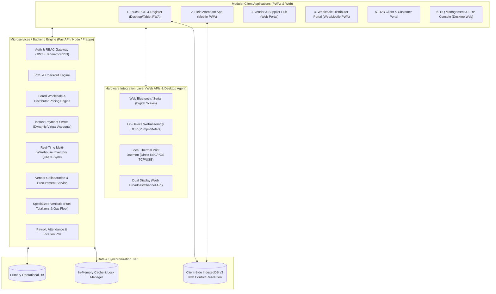
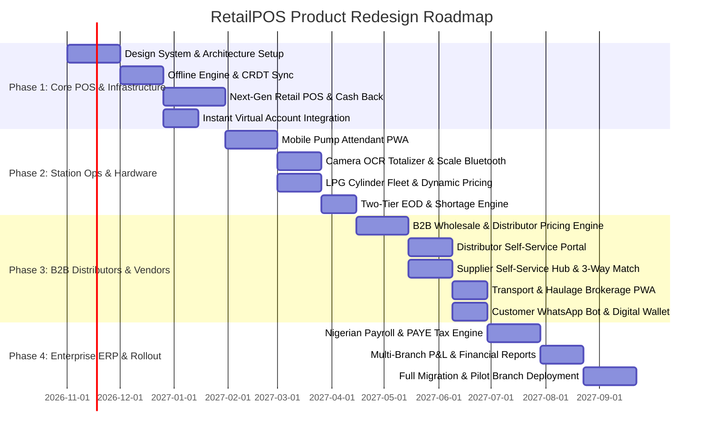
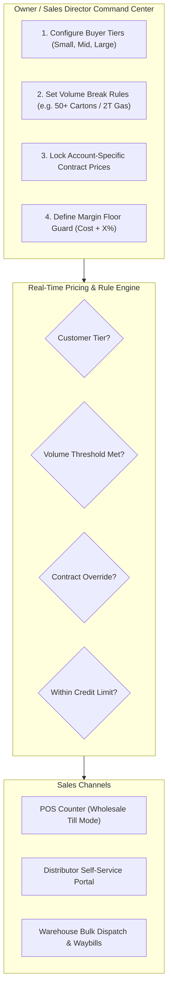

# Next-Gen RetailPOS: Comprehensive Product Redesign Roadmap & Blueprint

Based on the architectural audit of the legacy system, this document outlines the end-to-end redesign roadmap for the **RetailPOS Platform**. This blueprint re-architects the system into an ultra-modern, modular, and high-performance operating system designed for scale, frictionless internal operations, automated vendor collaboration, and **B2B Wholesale / Distributor Tiered Commerce**.

---

## 1. Strategic Vision & Core Objectives

### 1.1 The Problems with the Current Architecture
1. **Monolithic Bundle & Vertical Bloat**: A single 2.24 MB client bundle combines Supermarket POS, LPG Plants, Petrol Stations, Haulage Logistics, and Enterprise Payroll. A mobile pump attendant is forced to download ERP desktop accounting bundles.
2. **Manual Reconciliation Friction**: Cashiers manually confirm bank transfers, calculate cash-back math, and enter manual scale/meter readings.
3. **Vendor & Distributor Disconnect**: External suppliers, wholesale distributors, and transporters have zero self-service visibility. PO confirmations, wholesale price lists, bulk orders, and invoice reconciliations happen over external phone calls and paper waybills.
4. **Basic Offline Queueing**: The current IndexedDB store lacks structured conflict resolution, meaning simultaneous offline sales across multiple tills can lead to inventory drift.
5. **Rigid Pricing for Bulk Buyers**: The legacy app has a simplistic per-KG price group table (`/group-prices`), lacking dynamic quantity breaks, customer-specific contract overrides, minimum order quantities (MOQ), and distributor credit control.

### 1.2 Redesign North Star Metrics
- **Sub-Second POS Checkout**: Under 800ms per transaction from item scan to receipt trigger.
- **Dedicated Role-Tailored Interfaces**: Lightweight Progressive Web Apps (PWAs) tailored specifically to device form factors (Touch POS, Mobile Attendant, Vendor Hub, Distributor Portal, Desktop HQ).
- **Automated Bank Transfer Verification**: Instant dynamic Virtual Account / QR generation with live webhook payment confirmation.
- **End-to-End Vendor Lifecycle**: Fully automated 3-Way Matching (PO ↔ Delivery Note / GRN ↔ Supplier Invoice).
- **Multi-Tier Distributor Engine**: Frictionless wholesale pricing supporting Small, Mid, and Large bulk buyers with volume break matrices, credit limits, and self-service ordering.
- **Zero-Trust Cash Reconciliation**: Hardware-assisted audit trails (camera OCR for totalizers, automated scale capture).

---

## 2. Redesigned System Architecture

---

## 3. Dedicated User Experience (UX) Frameworks

### 3.1 Internal Users (Staff, Cashiers, Attendants, Managers)

#### A. POS Till Operators & Cashiers
- **100% Keyboard-Navigable Power Mode**:
  - Full hotkey mapping (`F1`: Customer Search, `F2`: Discount, `F3`: Cash Back, `F4`: Reserve Pickup, `Space`: Quick Cash Checkout).
  - Quantity prefixes: Type `5*` followed by barcode scan or search.
- **Wholesale Bulk Mode Switch**:
  - Selecting a registered Distributor instantly switches the till interface to **Wholesale Mode**: displays pack/carton/pallet/tonne UOMs, applies their assigned tier prices automatically, checks their available credit limit, and shows real-time quantity break discounts.
- **Smart Split-Tender Assistant**:
  - Automatic balance-due deduction as payment channels are tapped.
  - One-tap "Exact Amount", "Next Round ₦1,000 / ₦5,000", and "Save Change to Store Credit".
- **Dynamic Virtual Account Transfer Checkout**:
  - System generates a dynamic 1-time virtual bank account / QR code displayed directly on the customer screen.
  - The till automatically chimes and closes the invoice the instant the bank webhook fires.
- **Hardware-Integrated Cash Back**:
  - Displays instant visual till liquidity gauges. If cash back would reduce till below minimum float, the button safely locks with an explanatory badge.

#### B. Petrol & LPG Station Attendants
- **Mobile-First PWA (Thumb-Zone Navigation)**:
  - High-contrast outdoor mode for direct sunlight readability.
  - Large numerical keypad designed for one-handed operation.
- **Camera OCR Meter Capture**:
  - Snaps a photo of the pump mechanical totalizer; on-device computer vision extracts the meter numbers and computes volume dispensed.
- **Direct Load Cell / Bluetooth Scale Integration**:
  - Reads weight directly from Bluetooth-enabled digital scales during LPG cylinder filling, eliminating human error or under-filling.

#### C. Branch Managers & Business Owners
- **Owner Pricing Command Center (`/wholesale-pricing`)**:
  - Drag-and-drop tiered pricing matrix for Small, Mid, and Large buyers.
  - Visual margin safety sliders: alerts the owner if a wholesale price drops below `Cost + Minimum Margin %`.
  - Account-specific contract overrides with locked validity dates.
- **Visual Discrepancy Heatmap**:
  - Real-time dashboard highlighting tills or pumps with variances greater than 0.5%.
  - Side-by-side reconciliation of theoretical tank stock vs. physical dip measurements.

---

### 3.2 External Stakeholders (Suppliers, Transporters, B2B Clients, Customers)

#### A. Vendor & Supplier Hub (`/portal/vendors`)
- **Self-Service Order Management**:
  - Suppliers receive instant WhatsApp and email notifications when a Purchase Order is raised.
  - Ability to accept, suggest date amendments, or split deliveries directly online.
- **Advance Shipping Notice (ASN) & Electronic Waybills**:
  - Vendors submit digital dispatch notes with truck/driver details before arriving at the warehouse.
  - Storekeepers verify against the digital ASN using barcode scanning.
- **Automated 3-Way Matching & Invoicing**:
  - Suppliers upload e-invoices. The system matches PO ↔ Goods Received Note ↔ Supplier Invoice.
  - Real-time payment tracking showing "Scheduled for Payment", "Approved by Finance", or "Paid with Bank Ref".

#### B. Transport & Haulage Drivers
- **Driver Mobile Dispatch PWA**:
  - Drivers view pickup and drop-off coordinates, cargo manifests, and client contact details.
  - In-app proof-of-delivery (signature capture + delivery photo).
  - Instant diesel allowance and road expense claim submission.

#### C. Retail & B2B Customers
- **Digital Receipts & WhatsApp Bot**:
  - Instant paperless receipt sent via WhatsApp with an interactive button to view purchase history or loyalty point balance.
- **LPG Refill Subscription & Smart Reminders**:
  - Automated WhatsApp reminders 48 hours before predicted gas exhaustion with a 1-tap "Order Delivery" link.

---

### 3.3 Wholesale Distributors & Bulk Buyers (New Module)

#### Dedicated Distributor Self-Service Portal (`/portal/distributor`)
Designed for businesses who buy in bulk to resell to end-consumers (e.g. neighborhood retailers, sub-dealers, commercial bakeries, mini-gas plants):

1. **Personalized Catalog & Live Tier Pricing**:
   - When a distributor logs in, all product prices automatically reflect their assigned tier (**Small**, **Mid**, or **Large** distributor) and any custom negotiated contract rates.
   - Shows live inventory availability at their assigned pickup depot/warehouse.
2. **Bulk Order Booking & Requisition**:
   - Order in wholesale units (Cartons, Crates, Metric Tonnes, Bags, 50kg Cylinders).
   - Real-time tier upgrade suggestions: *"Add 12 more cartons to unlock Tier 3 pricing (save ₦45,000)!"*
   - Pick delivery option: Warehouse Self-Pickup (generates secure pickup code) or Factory Direct Haulage Dispatch.
3. **Credit Line & Ledger Statements**:
   - Displays real-time **Credit Limit**, **Used Credit**, **Available Credit**, and **Due Date**.
   - Download official PDF statement of accounts and tax invoices.
   - 1-click payment via integrated Virtual Bank Transfer with instant credit limit restoration upon confirmation.
4. **Circulating Asset & Deposit Tracking**:
   - For LPG and beverage distributors: tracks returnable asset balances (e.g., *Cylinders Held: 150 | Cylinders Returned: 120 | Pending Return: 30*).

---

## 4. Module-by-Module Redesign Roadmap

---

### Module 1: Core POS & Cashier Experience
*Target Milestone: Phase 1*

| Feature Area | Current Legacy System | Redesigned Implementation |
| :--- | :--- | :--- |
| **Checkout Interface** | Single monolithic table/grid, mouse-heavy. | Split-screen ergonomic layout with numpad drawer, full hotkeys, and dark/light adaptive mode. |
| **Wholesale POS Mode** | None; cashiers manually type price overrides. | Automatic wholesale detection upon customer selection; loads carton/tonne UOMs and tier rates. |
| **Bank Transfer Payment** | Manual cashier visual check; error-prone. | Dynamic Virtual Account generated on customer display; auto-reconciled via instant webhooks. |
| **Cash Back at POS** | Basic calculation; risk of till depletion. | Automated float balance guard, customizable tier fees, dual-voucher print for audit. |
| **Order Pickups** | Basic 6-letter text code verification. | QR code scan or 6-letter numeric OTP with SMS/WhatsApp push notification on customer arrival. |

---

### Module 2: Station Ops & Specialized Verticals (Fuel & LPG)
*Target Milestone: Phase 2*

| Feature Area | Current Legacy System | Redesigned Implementation |
| :--- | :--- | :--- |
| **Attendant Shift Interface** | Web view inside large desktop bundle. | Standalone ultra-light PWA (<150KB) designed for 5-inch handheld touchscreens. |
| **Meter Totalizer Reading** | Manual digit typing. | Camera OCR meter scan with automated fraud detection and physical image audit log. |
| **LPG Cylinder Fleet** | Simple list and count. | RFID / Barcode cylinder tracking (tracking cylinder age, test date, tare weight, customer deposit). |
| **Digital Scale Integration** | Manual keyboard entry of cylinder weight. | Web Bluetooth / Web Serial API connecting directly to digital platform scales. |
| **Station Generator Fuel** | Basic issue form. | Automated generator runtime efficiency calculation (litres consumed per generator operating hour). |

---

### Module 3: B2B Wholesale & Tiered Distributor Pricing Engine (New Module)
*Target Milestone: Phase 3*

This module gives business owners total control over bulk sales channels:

#### Detailed Feature Breakdown:
1. **Three-Tier Distributor Architecture**:
   - **Tier 1: Small Bulk Resellers**: Lower volume entry tier (e.g. 10–49 units / 100–499 kg), Cash on Delivery or Net 3 days, standard wholesale discount (e.g. 5% off retail).
   - **Tier 2: Mid Wholesalers**: Medium volume tier (e.g. 50–199 units / 500–2,499 kg), Net 14 days, higher discount (e.g. 10% off retail), designated delivery priority.
   - **Tier 3: Mega / Key Account Distributors**: Large volume tier (e.g. 200+ units / 2.5+ metric tonnes), custom credit limits (e.g. ₦10,000,000), factory-direct pricing, Net 30 days.
2. **Dynamic Volume Breaks (Quantity Break Pricing)**:
   - System automatically discounts line items as volume thresholds are crossed in the cart:
     - 1–9 items: Standard Retail (₦1,250/unit)
     - 10–49 items: Small Distributor (₦1,180/unit)
     - 50–199 items: Mid Wholesaler (₦1,120/unit)
     - 200+ items: Large Mega Distributor (₦1,050/unit)
3. **Owner Margin Floor Guard**:
   - Protects against cashier error or unauthorized discounting: if a cashier attempts a price below `Landed Cost + Configured Margin (e.g., 6%)`, the till blocks with supervisor PIN approval required.
4. **Credit Control & Auto-Lock**:
   - Each distributor profile has: Credit Limit, Payment Terms, and Grace Days.
   - If an invoice is overdue past grace days, the system automatically prevents new orders across both POS and the self-service portal until cleared.
5. **Circulating Deposit Asset Accounting**:
   - Reconciles returned physical assets (gas cylinders, pallets, crates) against new product releases, ensuring distributors do not abscond with company containers.

---

### Module 4: Vendor, Procurement & Supply Chain
*Target Milestone: Phase 3*

| Feature Area | Current Legacy System | Redesigned Implementation |
| :--- | :--- | :--- |
| **Vendor Collaboration** | Non-existent; phone calls and paperwork. | Dedicated **Vendor Hub** for PO acceptance, dispatch schedules, and invoice uploads. |
| **Goods Receiving (GRN)** | Manual keyboard entry against PO. | Mobile barcode scanning of vendor delivery boxes with instant discrepancy warnings. |
| **Invoice Reconciliation** | Manual paper matching. | Automated **3-Way Matching Engine** (matching PO quantities, GRN received weights, and invoice amounts). |
| **Vendor Ageing & Payments** | One-sided ageing report in finance. | Interactive payment calendar, supplier self-service payment receipts, and payment batching. |

---

### Module 5: Cash Drawer, Shifts & End-of-Day (EOD)
*Target Milestone: Phase 2*

| Feature Area | Current Legacy System | Redesigned Implementation |
| :--- | :--- | :--- |
| **Shift Closing** | Manual form entry. | Guided step-by-step blind cashier count wizard with automated denomination counter. |
| **Shortage Management** | Manual notes and split logic. | Interactive shortage liability assignment with digital staff sign-off and payroll link. |
| **Branch EOD Consolidation** | Fragmented screens across retail, fuel, LPG. | Unified branch closing matrix aggregating supermarket tills, fuel nozzles, and bulk gas tanks. |
| **Audit & Approvals** | Basic approve/reject button. | Visual discrepancy dashboard with drill-down into every voided line, discount, and cash refund. |

---

### Module 6: Customer CRM, Loyalty & Engagement
*Target Milestone: Phase 3*

| Feature Area | Current Legacy System | Redesigned Implementation |
| :--- | :--- | :--- |
| **Refill Due Prediction** | Simple historical average. | Machine-learning consumption forecasting accounting for household size and seasonal trends. |
| **Messaging & Reminders** | Manual click-to-WhatsApp link. | Automated WhatsApp Business API integration sending personalized refill alerts and birthday rewards. |
| **Loyalty Program** | Basic flat points. | Multi-tier loyalty club (Bronze, Silver, Gold, Platinum) with digital Apple/Google Wallet pass cards. |

---

### Module 7: HR, People & Nigerian Payroll
*Target Milestone: Phase 4*

| Feature Area | Current Legacy System | Redesigned Implementation |
| :--- | :--- | :--- |
| **Attendance Capture** | Manual manager check-in list. | Geofenced mobile selfie check-in or biometric USB integration at the branch till. |
| **Salary Advances** | Basic form. | Automated credit-scoring advance requests with repayment schedules automatically deducted at payroll. |
| **Statutory Compliance** | Hardcoded split. | Configurable Nigerian tax rules (PAYE brackets, Pension reform act, NHF, ITF, NSITF). |
| **Payslip Distribution** | Manual PDF download. | Automated password-protected PDF payslips delivered directly to staff WhatsApp/Email. |

---

## 5. Technical Implementation Blueprint

### 5.1 Technology Recommendations
1. **Frontend Architecture**:
   - **Framework**: Next.js 15 (App Router) or Vite + React 19.
   - **Styling**: TailwindCSS v4 with CSS variables for strict design tokens.
   - **State Management**: Zustand for local state + TanStack Query v5 for server state caching.
   - **Offline Storage**: `Dexie.js` (IndexedDB wrapper) with background Web Worker synchronization.
2. **Backend & Microservices**:
   - **Core Transaction API**: FastAPI (Python) or NestJS (TypeScript) for high-concurrency till requests.
   - **Pricing Engine**: In-memory Redis cached rules evaluating customer tier, quantity breaks, and margin floors in <5ms.
   - **Database**: PostgreSQL with row-level security and JSONB support for flexible item attributes.
   - **ERP Backend**: Continue leveraging ERPNext/Frappe for accounting ledger and inventory journals via clean REST/gRPC wrappers.
3. **Hardware Connectivity**:
   - **Desktop Agent**: Tauri or Electron shell providing raw TCP/USB hardware access.
   - **Web Native**: Web Serial API, Web Bluetooth API, and HTML5 Web Workers.

---

## 6. Execution Milestones & Deliverables

| Phase | Duration | Core Deliverables | Success Criteria |
| :--- | :--- | :--- | :--- |
| **Phase 1: Core POS & Payments** | Weeks 1–8 | Next-gen POS interface, keyboard navigation, dynamic virtual accounts, offline CRDT sync. | Checkout time < 1 sec; 100% offline checkout functionality. |
| **Phase 2: Station Operations & Hardware** | Weeks 9–16 | Mobile pump attendant PWA, totalizer camera OCR, digital scale Bluetooth integration, unified EOD. | Pump shift handover completed under 3 minutes; zero manual meter math. |
| **Phase 3: B2B Distributors & Vendor Hub** | Weeks 17–24 | Tiered wholesale pricing engine (Small, Mid, Large), distributor self-service portal, 3-way vendor matching. | 80% distributor repeat orders placed self-service; zero margin-floor violations. |
| **Phase 4: HR, Payroll & Full ERP Rollout** | Weeks 25–32 | Nigerian payroll engine, geofenced attendance, branch P&L analytics, pilot store deployment. | Error-free monthly payroll run in under 5 minutes; 100% branch accounting ledger reconciliation. |

---

*This specification serves as the blueprint for transforming Fetolsa Retail POS into a best-in-class multi-vertical retail and wholesale distribution platform.*
